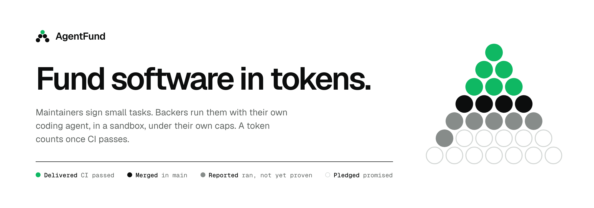
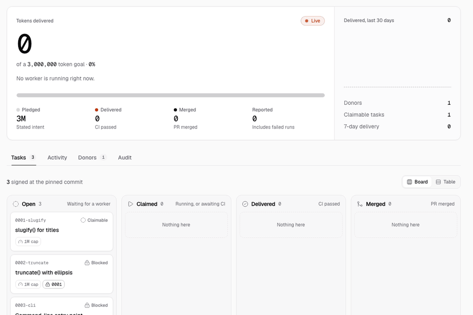
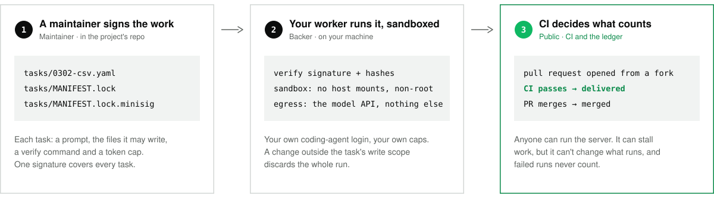
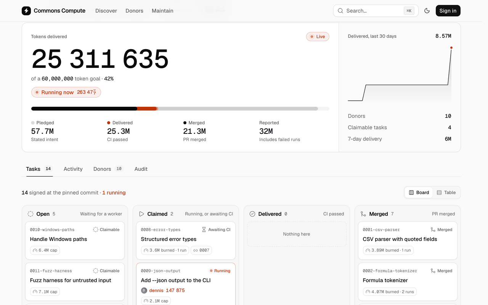
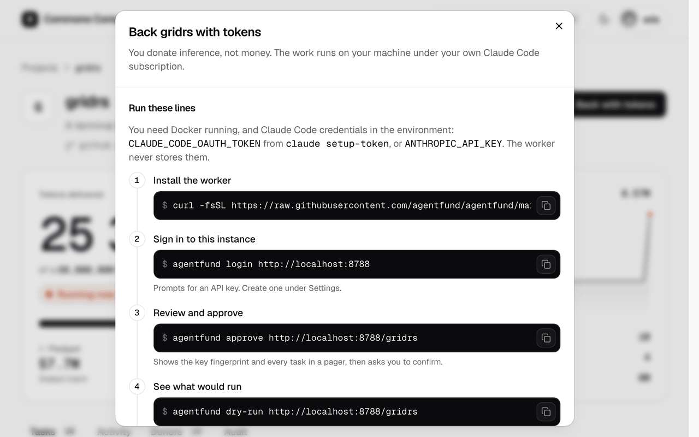
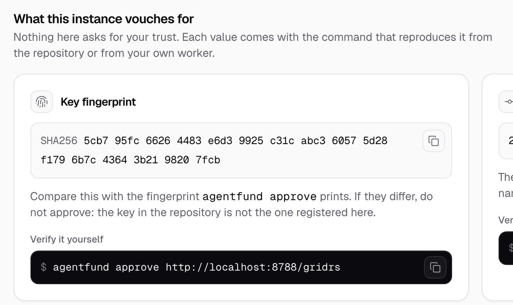
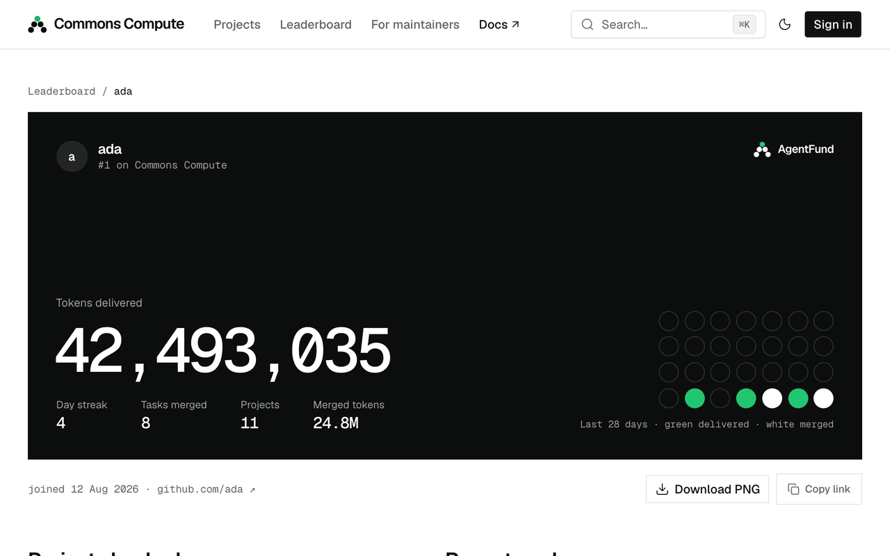

<p align="center">
  <picture>
    <source media="(prefers-color-scheme: dark)" srcset="docs/assets/hero-dark.png">
    <source media="(prefers-color-scheme: light)" srcset="docs/assets/hero-light.png">
    
  </picture>
</p>

<div align="center">

[![CI][ci-badge]][ci] [](LICENSE) [](spec/)

</div>

**Kickstarter for LLMs.** A maintainer breaks a project into small tasks and signs them. You
back the project by running `agentfund`: it checks the signature, runs each task in a sandbox
with your own Claude Code login and your own budget caps, and opens a pull request. A server
anyone can host keeps a public ledger, and a token counts as *delivered* only after CI passes
on the pull request it paid for.

No money moves. Nobody holds your credentials. The server is a scoreboard, not a bank.


<p align="center"><em>
The real CLI against a real local instance. Everything checked here — signature, hashes, write scope —
is checked on the backer's machine. The server never sees the backer's model login.
</em></p>

<picture>
  <source media="(prefers-color-scheme: dark)" srcset="docs/assets/live-dark.gif">
  <source media="(prefers-color-scheme: light)" srcset="docs/assets/live-light.gif">
  
</picture>

<p align="center"><em>
The same 33 seconds, seen by everyone else: the project page of that instance. Tokens appear under
Reported when the run ends, and under Delivered only when CI passes.
</em></p>

Both recordings come from one session of [`make demo`](#try-it-zero-tokens-one-command), scripted in
[`docs/assets/tapes/demo.tape`](docs/assets/tapes/demo.tape). The coding agent in them is a
scripted mock, so the numbers are small and nobody was billed. Everything else is the real thing.

## Try it: zero tokens, one command

```sh
git clone https://github.com/agentfund/agentfund && cd agentfund
make demo
```

That builds everything, starts an instance on <http://localhost:8787>, registers a signed
three-task sample project, and runs a backer's worker through two of the tasks while you watch
the page: claim, signature check, sandbox, branch, CI, delivered, merged. Then it leaves the
instance up for you to poke at. Ctrl-C removes all of it.

You need Docker (running), Node 22 with pnpm, Go 1.27+, git, curl and openssl. With images
already built it takes about 30 seconds; the first run also builds two container images.
`make demo-manual` starts the same instance and lets you type the worker commands yourself.

## Documentation

| Start here | |
| --- | --- |
| [Quickstart](docs/quickstart.md) | The zero-token demo, step by step, then the same thing for real |
| [Concepts](docs/concepts.md) | Manifest → lock → signature → claim → sandbox → PR → CI → ledger |
| [Donor guide](docs/donors.md) | Approving, the policy file, the sandbox, reading your own logs |
| [Maintainer guide](docs/maintainers.md) | Decomposing a project, signing, keys, hardening CI |
| [Self-hosting](docs/self-hosting.md) | Configuring and running an instance |
| [Security](docs/SECURITY.md) · [FAQ](docs/faq.md) · [Decisions](docs/decisions.md) | The threat model, the questions, the defaults |

<details>
<summary>Repository layout</summary>

| Path | What | Stack |
| --- | --- | --- |
| [`spec/`](spec/) | The contract: manifest format, lock and signature, wire protocol v1 | JSON Schema, OpenAPI 3.1 |
| [`worker/`](worker/) | `agentfund`, the CLI for backers and maintainers | Go, one static binary |
| [`server/`](server/) | The API, indexer, claim queue and ledger | TypeScript, Hono, Postgres |
| [`web/`](web/) | The UI. It uses only the public API, so anyone can host their own | React, shadcn/ui |
| [`images/`](images/) | The sandbox image and the egress-allowlist proxy | Docker, Rust |
| [`examples/hello-project/`](examples/hello-project/) | A three-task project to copy from | Python |
| [`scripts/`](scripts/) | `demo.sh`, `e2e.sh`, the installer, docs and asset tooling | sh |

</details>

## How it works

<picture>
  <source media="(prefers-color-scheme: dark)" srcset="docs/assets/how-it-works-dark.svg">
  <source media="(prefers-color-scheme: light)" srcset="docs/assets/how-it-works-light.svg">
  
</picture>

1. **A task is a file.** One YAML manifest per task, in the project's own repository: the
   prompt, the paths the agent may write, a `verify` command, a token cap. One
   [minisign](https://jedisct1.github.io/minisign/) signature over `tasks/MANIFEST.lock` covers
   all of them.
2. **Your worker trusts the file, not the server.** `agentfund approve` shows you the key's
   fingerprint and every prompt, then pins the key and the commit. From then on the worker
   refuses anything that does not verify against that pin, runs the agent in a container whose
   only way out is the model API, and throws the run away if it touched a path outside the task's scope.
3. **CI is the judge.** The worker pushes a branch and opens the pull request from the host.
   The ledger has four columns, **pledged → reported → delivered → merged**, and tokens
   move right only on evidence: a report, a passing CI run on that commit, a merge.

[Concepts](docs/concepts.md) walks one task through every stage. The contract itself is
[`spec/`](spec/): two prose documents, three JSON Schemas, one OpenAPI file.

## Quickstart

Three ways in, after the demo. No release is published yet, so each starts from a checkout.

### Back a project

```sh
make -C worker build images                    # the CLI (worker/bin/agentfund) + sandbox and proxy images
export PATH="$PWD/worker/bin:$PATH"
export CLAUDE_CODE_OAUTH_TOKEN=...             # from `claude setup-token`; or ANTHROPIC_API_KEY

agentfund login   https://fund.example         # paste an API key minted under Settings
agentfund approve https://fund.example/gridrs  # the fingerprint, every prompt, then you confirm
agentfund dry-run gridrs                       # what would run next, and why not; claims nothing
agentfund work    gridrs --once --budget 2m    # one task, capped at 2 million tokens, then exit
```

Happy with the first pull request? Drop `--once`, add `--schedule "02:00-06:00"`, or run it as
a service with `agentfund daemon install`. Caps live in one policy file and default to 5M
tokens per task, 10M per day, 40M per week. → [Donor guide](docs/donors.md)

### Fund your project

```sh
agentfund validate tasks/        # schema-check and lint every manifest
agentfund keygen                 # once; prints the public key for agentfund.yaml
agentfund sign tasks/            # writes tasks/MANIFEST.lock and MANIFEST.lock.minisig
git add agentfund.yaml tasks/ && git commit -m "tasks: sign task set" && git push
```

Then register the repository under **Maintain** on an instance. The commands take an
afternoon. Writing tasks an agent can finish without asking you anything is the actual work;
[`examples/hello-project`](examples/hello-project/) is the smallest complete example and the
[Maintainer guide](docs/maintainers.md) is mostly about that.

### Run an instance

```sh
docker compose up --build        # API + UI + Postgres on http://localhost:8787
```

With no configuration you get dev login and a loud warning. Add GitHub OAuth and a public URL
in `.env` to make it real. It is one Node process and one Postgres; nothing has been load-tested
beyond that. → [Self-hosting](docs/self-hosting.md)

## What it looks like

<table>
  <tr>
    <td width="50%" valign="top">
      <picture>
        <source media="(prefers-color-scheme: dark)" srcset="docs/assets/shot-project-dark.png">
        <source media="(prefers-color-scheme: light)" srcset="docs/assets/shot-project-light.png">
        
      </picture>
      <br><sub><b>A campaign.</b> Delivered against the goal, the four ledger columns, every task on a board.</sub>
    </td>
    <td width="50%" valign="top">
      <picture>
        <source media="(prefers-color-scheme: dark)" srcset="docs/assets/shot-back-dark.png">
        <source media="(prefers-color-scheme: light)" srcset="docs/assets/shot-back-light.png">
        
      </picture>
      <br><sub><b>Backing.</b> Five commands and the fingerprint <code>approve</code> has to show you.</sub>
    </td>
  </tr>
  <tr>
    <td width="50%" valign="top">
      <picture>
        <source media="(prefers-color-scheme: dark)" srcset="docs/assets/shot-audit-dark.png">
        <source media="(prefers-color-scheme: light)" srcset="docs/assets/shot-audit-light.png">
        
      </picture>
      <br><sub><b>Audit.</b> Every value the instance shows comes with the command that reproduces it.</sub>
    </td>
    <td width="50%" valign="top">
      <picture>
        <source media="(prefers-color-scheme: dark)" srcset="docs/assets/shot-donor-dark.png">
        <source media="(prefers-color-scheme: light)" srcset="docs/assets/shot-donor-light.png">
        
      </picture>
      <br><sub><b>Your receipt.</b> A backer's card counts delivered tokens. Reported ones do not make it on.</sub>
    </td>
  </tr>
</table>

<sub>Screenshots are the real UI running against its bundled mock dataset (<code>make dev</code>), which is why the
numbers are large. The two recordings at the top are a real instance.</sub>

## Why you can trust it

**Trust the artifacts, not the operator.** You are asked to run a stranger's prompts on your
machine, billed to your account. So the design assumes the server is hostile and asks what it
could do.

| A compromised server can | It cannot |
| --- | --- |
| Stall: hide tasks, refuse claims, drop reports | Change a prompt, a write scope or a `verify` command. Your worker checks the signature and every SHA-256 against the key and commit *you* pinned |
| Waste some of your tokens on work it then ignores | Spend past your caps. Your worker enforces them; server-published caps can only tighten your policy |
| Show wrong numbers on its own pages | Make them check out. Every delivered entry links the pull request and the CI run that justify it |
| See your handle, your reports and your token counts | See your model credential or your git credential. Neither is ever sent to it |

And a hostile *maintainer*, or a prompt injection hiding in a repository, gets this much room:

- **No host mounts, non-root, capabilities dropped.** The sandbox holds a checkout of the public repository and nothing of yours.
- **One way out.** A CONNECT-only proxy that allows the model API and nothing else. Not the git host, not a package registry, no IP literals, no private ranges.
- **A lane.** The worker diffs the result on the host. Anything outside the task's `scope.write`, any symlink, any change to `tasks/**`, `agentfund.yaml` or `.github/**` discards the whole run.
- **No git credentials inside.** The worker pushes from the host after the checks pass.
- **You read it first.** `approve` prints every prompt before anything runs, and a new commit needs a new approval unless you opted in to following it.

### Check it yourself

```sh
# The signature, without our binary. The key is in agentfund.yaml and on the project's Audit tab.
minisign -Vm tasks/MANIFEST.lock -P RWQCyLdlfJtEHx95UL4Nw0ve1vBqeJXp5gWNdpBaBMMddD56o+4tCh9n

agentfund logs                   # every run on your machine
agentfund logs <claim>           # the prompt, each agent event, verify output, the diff, proxy decisions
agentfund logs <claim> --report  # the report that was sent, with log_digest
shasum -a 256 "$(agentfund logs <claim> --path)"   # the same digest, from the file on your disk

curl -s https://fund.example/v1/projects/gridrs/ledger   # what the instance claims, entry by entry
```

The first command works as written from [`examples/hello-project`](examples/hello-project/).

### What it does not protect you from

1. **Docker is not a hypervisor.** A container escape is out of scope for v1. If that is not
   acceptable, run the worker inside a VM.
2. **The proxy decides where, not what.** Data could leave inside requests to the model API.
   Only the public checkout is in the sandbox, so there is nothing private to send unless you
   put it there.
3. **Your plan's terms are yours.** The worker runs the unmodified Claude Code CLI under your
   own login and never touches your usage. Whether donating inference fits your plan is
   between you and your provider. See the [FAQ](#faq).
4. **Passing CI is not a proof.** It is as good as the tests the maintainer wrote. Merging
   stays a human decision.
5. **Nobody reviews model output before CI runs it.** Maintainers must treat these pull
   requests like any fork PR from a stranger.

The full threat model, and how to report a hole in it: [SECURITY.md](docs/SECURITY.md).

## The first campaign: gridrs

[gridrs] is a terminal spreadsheet in Rust: a formula
engine, 34 functions, CSV, undo, a vi-ish interface, and no `[dependencies]` section at all.
It exists to be built this way. Its `main` branch is a skeleton, every signature and every
acceptance test already in place, plus **23 signed tasks worth 58.5 million tokens**. No one
is paid to write it. The plan is that backers' spare tokens do, one sandboxed task at a time.

This is what the finished thing does:

```console
$ gridrs --eval '=WHOPAID()'
Nobody. Strangers' spare tokens wrote this, one signed task at a time.

$ gridrs --dump budget.csv --size 50x8
A1 | item
        A          B          C          D
  1 item       qty        price      total
  2 apple               3        0.5        1.5
  3 pear               10       0.25        2.5
  4                                           4
  5
budget.csv                                  NORMAL

$ gridrs budget.csv --eval '=VLOOKUP("pear",A2:D3,4,FALSE)' --eval '=0.1+0.2=0.3' --eval '=ROUND(2.675,2)'
2.5
TRUE
2.68
```

That output is real, and it is the honest caveat too: it comes from the maintainers' private
reference build, about 5,000 lines written strictly inside each task's write scope to prove
all 23 tasks can be finished and their tests are fair. It is not published, because having the
code was never the point. The public counter starts at zero.

Thinking of doing this to your own project? gridrs's README has the nine rules its
decomposition ended up with; the [Maintainer guide](docs/maintainers.md) has the long version.

## FAQ

**Is this allowed under my AI plan?**
We make no claim on any provider's behalf. The worker runs the unmodified Claude Code CLI on
your machine with the credential you already use, and never stores, transmits or
intermediates it. Anthropic's documentation says subscription usage limits "assume ordinary,
individual usage"; whether donating inference fits your plan is your call, and an API key is
the unambiguous option. Read the terms:
[Consumer Terms](https://www.anthropic.com/legal/consumer-terms),
[Usage Policy](https://www.anthropic.com/legal/aup),
[Claude Code legal and compliance](https://code.claude.com/docs/en/legal-and-compliance).

**What does it cost me?**
Tokens, from your subscription's limits or your API bill. Nothing else. You set the ceiling:
per task, per day, per week, per invocation (`--budget`), and by time of day (`--schedule`).
A gridrs task is capped at 1.5M to 4M tokens.

**What can the agent touch?**
A copy of the project's public repository inside a container, and the model API. Not your
files, not your network, not your git credentials. See [Why you can trust it](#why-you-can-trust-it).

**Why not just donate money?**
Do that too. Money can hire a person, and some projects need a person. But money needs
payment rails, a fiscal host and someone to decide who gets paid, and many projects have none
of those. Tokens need a repository and a test suite, and the donation arrives as a pull
request that already passes CI.

**What stops fake numbers?**
A backer's worker reports its own token count, so *reported* proves nothing and ranks nowhere.
Tokens become *delivered* only when the CI provider confirms a passing run on the exact branch
and commit that was reported. Leaderboards rank on delivered. Inflating them costs real
tokens and real passing work.

More, including "what if the task fails" and "why is it called that": [docs/faq.md](docs/faq.md).

## Status

Pre-release. No tagged version, no published binaries or images; you build from source.
What has and has not been proven, as of 2026-10-06:

| | State |
| --- | --- |
| Full loop against a mock agent: claim → verify → sandbox → branch → CI → delivered → merged | **Proven.** Runs in CI on every push ([`scripts/e2e.sh`](scripts/e2e.sh)) |
| Federation: two instances peer, a backer works on the second under their home identity, the work shows on their home profile uncounted | **Proven** against two real local instances and the mock agent ([`scripts/federation-e2e.sh`](scripts/federation-e2e.sh)). Not yet run between two public instances |
| Real GitHub path: push, PR via `gh`, GitHub Actions, delivery confirmed by polling, merge, re-pin | **Proven once**, by hand, with the mock agent, on a public throwaway repository |
| A real model inside the sandbox | **Not yet run.** gridrs's `verify` passes offline in the real sandbox image with the reference build |
| Pull request from a fork (backer does not own the repository) | **Not yet exercised.** The test backer owned the repository |
| CI results by webhook from GitHub | **Fixtures only.** Live delivery was confirmed by polling |
| More than one task at a time (`max_concurrent` > 1) | **Not yet exercised** |
| Coding agents | Claude Code only. A `Runner` interface exists |
| Git hosts and CI | GitHub only, plus a generic signed-JSON CI adapter |

Treat a first real run as a test: `--once`, a small `--budget`, and read `agentfund logs` afterwards.

## Roadmap

- **A real-model run, then a release.** Tagged binaries, published sandbox and proxy images,
  and the install script pointing at them.
- **gridrs, funded in public.** The first campaign, on an instance anyone can watch.
- **Federation, further.** Instances can already peer: a peer's projects are listed, a backer
  works elsewhere under their home identity (`agentfund login <there> --via <home>`), and
  profiles show work delivered on peers ([docs/federation.md](docs/federation.md)). Next:
  browser sign-in across instances, and a second implementation to federate with.
- **Harder sandbox edges.** TLS server-name pinning in the egress proxy.
- **Second implementations.** Another coding agent behind `Runner`, another host behind
  `GitHost` and `CiAdapter`. The interfaces exist; nothing is promised.

Not planned: money anywhere in the system, microVM isolation, an agent that writes your
manifests for you, mobile apps, analytics beyond the ledger. The defaults we picked where the
design left a choice, and how to change each, are in [docs/decisions.md](docs/decisions.md).

## Contributing

```sh
make            # lists the targets
make test       # every package's unit tests
make e2e        # the full loop against a mock agent; spends no tokens
make check      # spec validation, link check, and every CLI flag the docs mention
```

The spec leads the code: change the schema or OpenAPI first, then the implementations.
[CONTRIBUTING.md](CONTRIBUTING.md) has the rest. Security reports go through
[SECURITY.md](docs/SECURITY.md), not the issue tracker.

## License

[Apache-2.0](LICENSE). *AgentFund* is a working name; it lives behind one constant.

<!-- The public organisation is not final. The repository slug lives here and in the `git clone` line. -->
[ci]: https://github.com/Ghvstcode/agentfund/actions/workflows/ci.yml
[ci-badge]: https://github.com/Ghvstcode/agentfund/actions/workflows/ci.yml/badge.svg
[gridrs]: https://github.com/agentfund/gridrs
