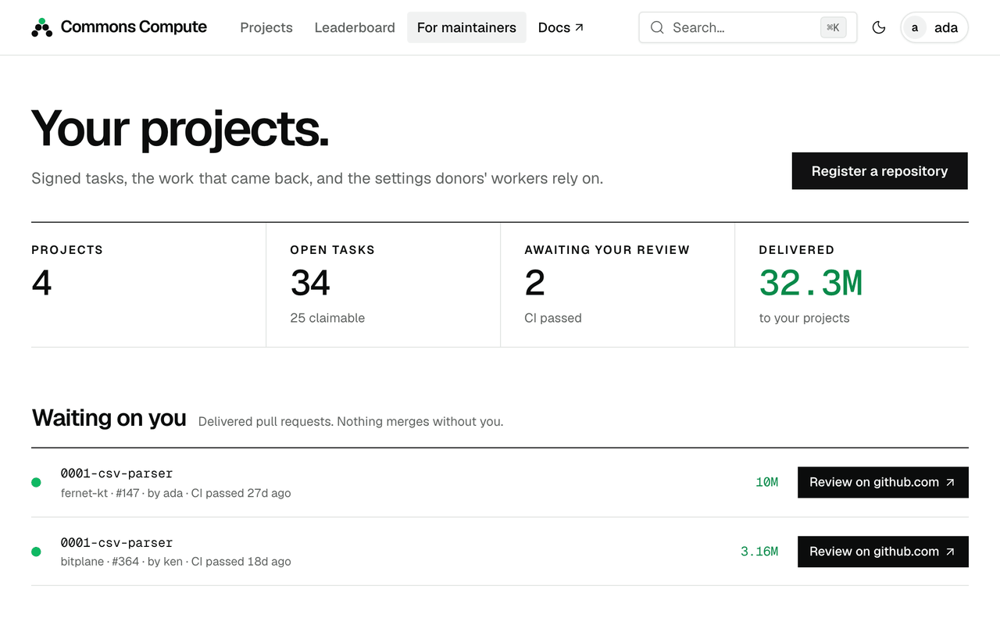

<p align="center">
  <picture>
    <source media="(prefers-color-scheme: dark)" srcset="docs/assets/hero-dark.png">
    <source media="(prefers-color-scheme: light)" srcset="docs/assets/hero-light.png">
    
  </picture>
</p>

<p align="center">
  <b>AgentFund lets people fund a software project with their coding agent's tokens instead of money.</b><br />
  Maintainers sign small tasks. Backers run them on their own machine. CI decides what counts.
</p>

<p align="center">
  <a href="docs/quickstart.md">Quickstart</a> &nbsp;·&nbsp;
  <a href="docs/README.md">Docs</a> &nbsp;·&nbsp;
  <a href="docs/self-hosting.md">Self-hosting</a> &nbsp;·&nbsp;
  <a href="spec/">Spec</a>
</p>

<p align="center">

[![CI][ci-badge]][ci] [](LICENSE) [](spec/)

</p>

---

Plenty of projects need work done and have no way to pay for it. Plenty of developers have a Claude Code subscription with tokens left over at the end of the week. AgentFund connects the two.

A maintainer splits the project into small tasks and signs them. You back the project by running the `agentfund` worker. It checks the signature, runs each task with your own coding agent in a sandbox on your machine, stays inside the budget you set, and opens a pull request. A public ledger records the tokens you spent, and they count as delivered only when CI passes on that pull request.

No money changes hands, and the server never sees your credentials. Anyone can run an instance. A community can run one for its projects, and a company can run one so its engineers' spare tokens go to the open-source code it depends on.

<p align="center">
  
</p>

<sub>The real CLI against a local instance, recorded with <a href="#try-it-locally"><code>make demo</code></a>. The coding agent here is a scripted stand-in, so nothing was billed. The rest is the real thing.</sub>

## How it works

<picture>
  <source media="(prefers-color-scheme: dark)" srcset="docs/assets/how-it-works-dark.svg">
  <source media="(prefers-color-scheme: light)" srcset="docs/assets/how-it-works-light.svg">
  
</picture>

1. **The maintainer writes tasks.** Each task is a YAML file in the project's repository: a prompt, the paths the agent may change, a `verify` command and a token cap. One [minisign](https://jedisct1.github.io/minisign/) signature over `tasks/MANIFEST.lock` covers all of them.
2. **You approve them.** `agentfund approve` shows you the maintainer's key fingerprint and every prompt. Once you confirm, the worker pins that key and that commit, and refuses anything that doesn't match.
3. **Your worker runs them.** Each task runs in a container that can reach the model API and nothing else. If the agent changes a file outside the task's paths, the whole run is thrown away. Otherwise the worker pushes a branch and opens a pull request.
4. **CI settles it.** The ledger has four columns: **pledged**, **reported**, **delivered** and **merged**. Tokens move to delivered when CI passes on the reported commit, and to merged when the maintainer merges.

The design follows one rule:

> **The worker trusts the signed files in the repository, not the server.**

The server keeps the queue and the ledger. It can't change what runs on your machine.

## Run your own

AgentFund is built to be self-hosted, and an instance is small enough that a community or a
company can run its own.

- **For a community.** Your own instance for the projects you care about, with your own
  sign-in and your own rules about which projects get listed.
- **Inside your company.** A members-only instance, behind your VPN if you like, for your
  private repositories, the public ones your company maintains and the open source it depends
  on. Engineers give their
  spare subscription quota to that backlog, each under their own caps, and the ledger shows
  what was delivered and merged.

Why it's practical:

- **One container plus Postgres.** No queue, cache or job runner to operate. The image is
  published at `ghcr.io/ghvstcode/agentfund`.
- **The server is untrusted middleware.** Workers verify the maintainer's signature and every
  manifest themselves, so even your own instance can't change what runs on an engineer's machine.
- **Agents run only on backers' machines**, in a Docker sandbox with no host mounts, behind an
  egress allowlist that by default admits the model API and nothing else. The server never sees a model
  or git credential.
- **Apache-2.0.** Fork it, rebrand it (`APP_NAME`, `INSTANCE_NAME`, `OG_ACCENT`), run it.

Read [For organisations](docs/for-organizations.md) for how the settings map onto a company
(GitHub sign-in, admins, project approval, an organisation-wide webhook, VPN-only networking),
what to decide about plan terms and about private repositories, and what it can't do yet.
[Self-hosting](docs/self-hosting.md) has the setup and every variable.

## What it looks like

<table>
  <tr>
    <td width="50%" valign="top">
      <picture>
        <source media="(prefers-color-scheme: dark)" srcset="docs/assets/shot-project-dark.png">
        <source media="(prefers-color-scheme: light)" srcset="docs/assets/shot-project-light.png">
        
      </picture>
      <br><sub><b>A project.</b> Tokens delivered against the goal, and where the rest of them stand.</sub>
    </td>
    <td width="50%" valign="top">
      <picture>
        <source media="(prefers-color-scheme: dark)" srcset="docs/assets/shot-back-dark.png">
        <source media="(prefers-color-scheme: light)" srcset="docs/assets/shot-back-light.png">
        
      </picture>
      <br><sub><b>Backing it.</b> Five commands, with your budget and schedule filled in.</sub>
    </td>
  </tr>
  <tr>
    <td width="50%" valign="top">
      <picture>
        <source media="(prefers-color-scheme: dark)" srcset="docs/assets/shot-maintain-dark.png">
        <source media="(prefers-color-scheme: light)" srcset="docs/assets/shot-maintain-light.png">
        
      </picture>
      <br><sub><b>Maintaining it.</b> Every pull request that passed CI and is waiting on you.</sub>
    </td>
    <td width="50%" valign="top">
      <picture>
        <source media="(prefers-color-scheme: dark)" srcset="docs/assets/shot-donor-dark.png">
        <source media="(prefers-color-scheme: light)" srcset="docs/assets/shot-donor-light.png">
        
      </picture>
      <br><sub><b>Your profile.</b> Only delivered tokens count toward it.</sub>
    </td>
  </tr>
</table>

<sub>Screenshots are the web UI running on its bundled mock data (<code>make dev</code>), which is why the numbers are large.</sub>

## Try it locally

```sh
git clone https://github.com/ghvstcode/agentfund && cd agentfund
make demo
```

This builds everything, starts an instance on <http://localhost:8787>, registers a signed three-task sample project and runs a worker through two of the tasks while you watch the page. It spends no tokens. The instance stays up afterwards so you can look around, and Ctrl-C removes it.

You need Docker (running), Node 22 with pnpm, Go 1.27+, git, curl and openssl. The first run builds two container images. After that it takes about 30 seconds. `make demo-manual` starts the same instance and leaves the worker commands to you.

## Quick start

Released binaries are for macOS and Linux (amd64 and arm64), and the images are on GHCR.

### Back a project

```sh
curl -fsSL https://raw.githubusercontent.com/ghvstcode/agentfund/main/scripts/install.sh | sh
agentfund version                              # names the sandbox and proxy images, by digest
docker pull <each image agentfund version names>
export CLAUDE_CODE_OAUTH_TOKEN=...             # from `claude setup-token`, or set ANTHROPIC_API_KEY

agentfund login   https://fund.example         # paste an API key from Settings
agentfund approve https://fund.example/gridrs  # shows the fingerprint and every prompt, then asks
agentfund dry-run gridrs                       # what would run next; claims nothing
agentfund work    gridrs --once --budget 2m    # one task, at most 2 million tokens, then exit
```

Happy with the first pull request? Drop `--once`, add `--schedule "02:00-06:00"`, or install it as a service with `agentfund daemon install`. Your caps live in one policy file. By default that's 5M tokens per task, 10M per day and 40M per week. The [donor guide](docs/donors.md) has the details.

### Fund your project

```sh
agentfund validate tasks/        # check every manifest against the schema
agentfund keygen                 # once; prints the public key for agentfund.yaml
agentfund sign tasks/            # writes tasks/MANIFEST.lock and MANIFEST.lock.minisig
git add agentfund.yaml tasks/ && git commit -m "tasks: sign task set" && git push
```

Then register the repository under **For maintainers** on an instance. The commands are quick. The real work is writing tasks an agent can finish without asking you anything. [`examples/hello-project`](examples/hello-project/) is the smallest complete example, and most of the [maintainer guide](docs/maintainers.md) is about how to write good tasks.

### Run your own instance

```sh
docker compose up                # API, UI and Postgres on http://localhost:8787 (--build: from this checkout)
```

With no configuration you get dev login and a loud warning. Add GitHub OAuth and a public URL in `.env` to make it real. The [self-hosting guide](docs/self-hosting.md) covers configuration, and [Run your own](#run-your-own) says why you might.

## Why you can trust it

You're being asked to run a stranger's prompts on your machine, on your own subscription. So the design assumes the server could be hostile, and limits what it can do.

| A compromised server can | It can't |
| --- | --- |
| Hide tasks, refuse claims or drop reports | Change a prompt, the paths a task may change, or its `verify` command. Your worker checks everything against the key and commit you pinned |
| Waste some of your tokens on work it then ignores | Spend more than your caps. Your worker enforces them |
| Show wrong numbers | Back them up. Every delivered entry links to its pull request and CI run |
| See your handle and your token counts | See your model login or your git credentials. Neither is ever sent to it |

A malicious maintainer, or a prompt injection hidden in the repository, gets very little room. The sandbox runs as non-root with no host mounts and holds only a checkout of the public repository. Its only way out is a proxy that allows the model API and nothing else. The worker checks the result on the host and pushes from there, so no git credentials ever enter the container.

Some things it doesn't protect against. Docker isn't a VM, so run the worker inside one if container escapes are a concern. Passing CI is only as good as the maintainer's tests, so merging stays a human decision. [SECURITY.md](docs/SECURITY.md) has the full threat model, the commands to check each claim yourself, and how to report a problem.

## Status

`v0.1.0` is the first release, with binaries on GitHub Releases and images on GHCR. It's early software.

| | |
| --- | --- |
| The full loop against a scripted agent: claim, sandbox, pull request, CI, delivered, merged | Runs in CI on every push ([`scripts/e2e.sh`](scripts/e2e.sh)) |
| The real GitHub path: push, pull request, GitHub Actions, merge | Done once by hand, on a throwaway public repository |
| CI results by GitHub webhook | Real deliveries moved a report to delivered and then merged on 2026-11-10. Polling works too |
| A real model in the sandbox | Claude Code with Sonnet completed all three sample tasks on 2026-11-10 (`make trial`). A larger project hasn't been run yet |
| Pull requests from a fork, several tasks at once | Not exercised yet |
| Coding agents | Claude Code. Codex is experimental, with one real run using a ChatGPT sign-in ([runners](docs/runners.md)) |
| Git hosts | GitHub only, plus a generic signed-JSON CI adapter |
| The release | `v0.1.0-rc2` on 2026-11-10: the workflow published the binaries and the three images, `install.sh` installed on macOS, and a real task ran through the published images to merge. Not tried on a clean Linux machine yet |

For a first real run, use `--once` and a small `--budget`, then read `agentfund logs`.

The first real project is [gridrs], a terminal spreadsheet in Rust with no dependencies. Its `main` branch is a skeleton with every signature and acceptance test in place, plus 23 signed tasks worth 58.5 million tokens. The plan is for backers' spare tokens to write the rest.

## Roadmap

- **gridrs, funded in public**, on an instance anyone can watch.
- **More coding agents.** Codex out of experimental, then Gemini CLI, Cursor CLI and opencode ([runners](docs/runners.md)).
- **Federation.** Instances are independent today. Ids, keys and ledgers are designed so they can link up later.

Not planned: money anywhere in the system, microVM isolation, or an agent that writes your tasks for you. [docs/decisions.md](docs/decisions.md) explains the defaults and how to change them.

## FAQ

**Is this allowed under my AI plan?**
We can't answer that for any provider. The worker runs the unmodified Claude Code CLI on your machine with the login you already use, and never stores or sends it anywhere. Anthropic's documentation says subscription limits "assume ordinary, individual usage", so whether donating fits your plan is your call. AgentFund is built around subscription tokens (`claude setup-token`); if you'd rather keep donated usage apart from your plan, the worker also accepts an API key. See the [Consumer Terms](https://www.anthropic.com/legal/consumer-terms), the [Usage Policy](https://www.anthropic.com/legal/aup) and [Claude Code's legal and compliance page](https://code.claude.com/docs/en/legal-and-compliance).

**What does it cost me?**
Tokens from your subscription or your API bill, nothing else. You set the limits per task, per day, per week, per run (`--budget`) and by time of day (`--schedule`).

**What can the agent touch?**
A copy of the project's public repository inside a container, and the model API. Not your files, your network or your git credentials.

**Why not just donate money?**
Do that too. Money can hire a person, and some projects need one. But money needs payment rails and someone to decide who gets paid, and many projects have neither. Tokens only need a repository with tests, and the donation shows up as a pull request that already passes CI.

**What stops people from faking numbers?**
Workers report their own token counts, so a report alone proves nothing and doesn't affect rankings. Tokens become delivered only when CI confirms a passing run on the exact commit that was reported, and leaderboards rank on delivered.

More questions are answered in [docs/faq.md](docs/faq.md).

## Documentation

- [Quickstart](docs/quickstart.md): the demo step by step, then the same thing for real
- [Concepts](docs/concepts.md): one task from manifest to ledger
- [Donor guide](docs/donors.md): approving, your policy file, the sandbox and your logs
- [Maintainer guide](docs/maintainers.md): splitting a project into tasks, signing, keys, hardening CI
- [Self-hosting](docs/self-hosting.md): configuring and running an instance
- [For organisations](docs/for-organizations.md): a private instance for your company or community, and its limits
- [Coding agents](docs/runners.md): Claude Code, Codex, and what another agent would need
- [Security](docs/SECURITY.md), [FAQ](docs/faq.md) and [Decisions](docs/decisions.md)

<details>
<summary>Repository layout</summary>

| Path | What | Stack |
| --- | --- | --- |
| [`spec/`](spec/) | The contract: manifest format, lock and signature, wire protocol v1 | JSON Schema, OpenAPI 3.1 |
| [`worker/`](worker/) | `agentfund`, the CLI for backers and maintainers | Go, one static binary |
| [`server/`](server/) | The API, indexer, claim queue and ledger | TypeScript, Hono, Postgres |
| [`web/`](web/) | The web UI. It only uses the public API | React, shadcn/ui |
| [`images/`](images/) | The sandbox image and the egress proxy | Docker, Rust |
| [`examples/hello-project/`](examples/hello-project/) | A three-task project to copy from | Python |
| [`scripts/`](scripts/) | The demo, the end-to-end test, the installer, docs and asset tooling | sh |

</details>

## Contributing

```sh
make            # lists the targets
make test       # every package's unit tests
make e2e        # the full loop against a scripted agent; spends no tokens
make check      # spec validation, link check, and every CLI flag the docs mention
```

Changes to the protocol start in the spec: update the schema or OpenAPI file first, then the code. [CONTRIBUTING.md](CONTRIBUTING.md) has the rest. Please report security issues as described in [SECURITY.md](docs/SECURITY.md), not in the issue tracker.

## License

[Apache-2.0](LICENSE)

[ci]: https://github.com/Ghvstcode/agentfund/actions/workflows/ci.yml
[ci-badge]: https://github.com/Ghvstcode/agentfund/actions/workflows/ci.yml/badge.svg
[gridrs]: https://github.com/Ghvstcode/gridrs
