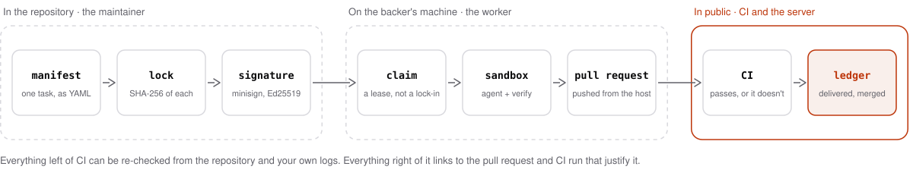

# Concepts

AgentFund is eight nouns in a row. This page follows one task through all of them. If you
ran the [demo](quickstart.md), you have already watched it happen.

<picture>
  <source media="(prefers-color-scheme: dark)" srcset="assets/pipeline-dark.svg">
  <source media="(prefers-color-scheme: light)" srcset="assets/pipeline-light.svg">
  
</picture>

Three places, three owners. The maintainer owns what is in the repository. The donor owns
what happens on their machine. CI and the public record own what counts. The server sits
between them and owns nothing that matters: that is the design.

## In the repository

### 1. Manifest

A task is one YAML file, `tasks/<id>.yaml`, in the project's own repository. This is the
first task of the sample project, whole:

```yaml
spec_version: 1
id: 0001-slugify
title: slugify() for titles
prompt: |
  Implement `slugify(text: str) -> str` in src/textutil.py.
  …
scope:
  write: [src/textutil.py, tests/test_slugify.py]
  read: [src/**, tests/**, README.md]
verify: python3 -m unittest discover -s tests -p "test_slugify.py"
max_tokens: 1000000
timeout_minutes: 20
```

| Field | What it controls |
| --- | --- |
| `prompt` | Given to the agent verbatim. Nothing is added by the server. |
| `scope.write` | The only paths the agent may change. Anything else discards the run. |
| `scope.read` | When set, everything else is removed from the sandbox's checkout. |
| `verify` | Runs in the sandbox after the agent. Exit 0 or the run is not published. |
| `max_tokens`, `timeout_minutes` | The run is killed at either. |
| `depends_on` | Tasks that must be *merged* first. |

A manifest is declarative. It cannot run a script on the donor's host, mount anything, or
widen its own network. Full reference: [`spec/manifest.md`](../spec/manifest.md).

### 2. Lock

`tasks/MANIFEST.lock` lists every manifest with its SHA-256. `agentfund sign` writes it.
Change one byte of one prompt and its hash no longer matches.

### 3. Signature

`tasks/MANIFEST.lock.minisig` is one [minisign](https://jedisct1.github.io/minisign/)
signature (Ed25519, prehashed) over the lock. One signature therefore covers every task. The
public key lives in `agentfund.yaml` and is registered with the instance, which shows its
fingerprint on the project's Audit tab: two channels for the same key, so swapping one is
visible. Rotating a key takes a statement signed by the old one.

Nothing about this needs our software to check:

```sh
minisign -Vm tasks/MANIFEST.lock -P <public key>
```

## On the donor's machine

### Approval comes first

Before any of the next three steps can happen, the donor runs `agentfund approve` once. It
clones the repository, verifies the signature, shows the key's fingerprint and every
manifest in full, and on a yes writes a **pin** to the donor's own config: the public key,
the commit, the hash of the lock. Every later check is against that pin, not against
anything the server says today.

### 4. Claim

The worker asks the server for a task. A claim is a **lease**, two hours by default, kept
alive by a heartbeat every minute. If the worker dies, the lease expires and the task
reopens. The claim names a commit and a content hash; the worker then runs the verification
chain itself, and executes nothing unless all of it passes:

1. Fetch the repository; the commit must exist.
2. The lock's signature verifies against the pinned key.
3. Every manifest matches its hash in the lock; the claimed task's hash matches the claim.
4. The commit is one the donor approved, or a later one under a follow policy the donor opted into.
5. The donor's own policy allows it: per-task ceiling, daily and weekly budgets, schedule, allowed git hosts.

A failure in 1 to 4 is reported as `verification_failed`. A refusal at 5 just releases the claim.

### 5. Sandbox

The task runs in a Docker container: non-root, capabilities dropped, no host mounts, on an
internal network whose only exit is a proxy that allows the model API and nothing else. The
agent is the unmodified Claude Code CLI under the donor's own credential, which is passed as
an environment variable at container start and stored nowhere.

When the agent stops, `verify` runs in the same sandbox. Then the worker, on the host, diffs
the result against the claimed commit. A change outside `scope.write`, a symlink, or any
change to `tasks/**`, `agentfund.yaml` or `.github/**` discards the whole run.
What this does and does not protect: [Security](SECURITY.md).

### 6. Pull request

Git credentials never enter the sandbox. The worker commits the diff on the host, pushes a
branch named `agentfund/<task-id>-<claim>`, opens the pull request with the donor's own `gh`
login, and sends the server a **report**: token counts, the branch, the head commit, and the
SHA-256 of its local log.

## In public

### 7. CI

The project's own CI runs on the pull request. The server learns the result from the CI
provider, by webhook or by polling, and only a result for the exact branch and head commit
in the report counts. A donor cannot report their way to delivered, and a maintainer cannot
sign a result for someone else's project: webhook secrets are per project.

### 8. Ledger

Four columns, per project and per donor. Tokens move right only on evidence.

| Column | Counts | Evidence | Who could fake it |
| --- | --- | --- | --- |
| **Pledged** | What donors said they intend to give | An API call | Anyone. It is a statement of intent and ranks nowhere |
| **Reported** | Tokens every run says it burned, failed runs included | The worker's own report | The donor. It ranks nowhere either |
| **Delivered** | Tokens of completed runs whose branch passed CI | The CI provider | Nobody without passing CI on real work |
| **Merged** | Tokens of delivered runs whose pull request merged | The git host | Nobody without the maintainer's merge |

Leaderboards, trending and profiles rank on **delivered**. `reported − delivered` is the
burned-but-failed total, and it stays visible. Every state change also appends a row to a
public event log that the database refuses to update or delete.

## Two more ideas

**Trust tiers.** A project is `new` until three of its tasks have merged. While it is new,
the server refuses claims on tasks capped above 5M tokens and stops granting claims after
25M tokens in a day. The numbers are the instance's defaults and it publishes them. A
worker applies its own caps regardless and never loosens them because of anything a server says.

**Moving commits.** Every merge moves the project to a commit the donor has not approved.
By default the worker stops and says so. `follow_unchanged_lock` keeps it working while the
signed task list is byte-identical to the one reviewed; `auto_follow_signed_updates` accepts
any validly signed list. Both are off unless the donor turns them on.

## What the server is for

Coordination: it indexes signed task sets, hands out leases so two workers do not do the
same task, receives reports, listens to CI and adds up the ledger. It is deliberately not
trusted with anything else. A compromised server can stall work and show wrong numbers on
its own pages; it cannot change what runs, spend past a donor's caps, or see a donor's
credentials. The table in the [README](../README.md#why-you-can-trust-it) spells that out.

## Next

- Running a worker: [Donor guide](donors.md)
- Writing tasks: [Maintainer guide](maintainers.md)
- The normative text: [`spec/manifest.md`](../spec/manifest.md), [`spec/protocol.md`](../spec/protocol.md)
